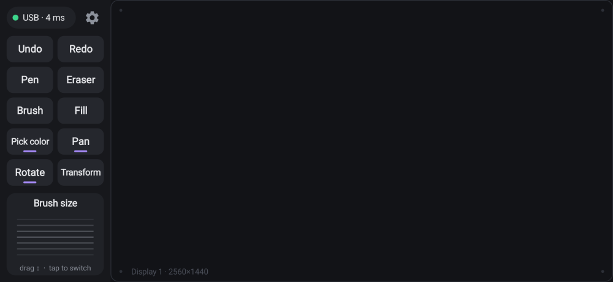

# PenBridge

Use your **Samsung Galaxy S24 Ultra and its S Pen as a drawing tablet** for your Windows PC,
like a Wacom Intuos. It supports pen pressure, hover, the S Pen side button, shortcut buttons and
a scroll dial. It's tuned for **Clip Studio Paint** and works with any app that supports Windows Ink.



| Part | File | Runs on |
|---|---|---|
| Phone app | `PenBridge-0.1.0.apk` | Android 10 or newer (made for the S24 Ultra) |
| PC program | `PenBridge.exe` | Windows 10 (version 1809 or newer) or Windows 11 |

It connects by **USB cable** (lowest delay) or **Wi‑Fi** (no cable). It tries USB first.

## Download

Get both files from the **[latest release](https://github.com/shDavlatbek/pen-bridge/releases/latest)**:
`PenBridge-0.1.0.apk` for the phone and `PenBridge.exe` for the PC.

---

## 1. Set up the PC (once)

1. Make a folder, for example `Documents\PenBridge`, and put `PenBridge.exe` in it.
2. Double-click `PenBridge.exe`. A black window opens and shows the connection status. Keep it open while you draw.
   - If Windows says **"Windows protected your PC"**, click **More info → Run anyway**.
     This appears because the program isn't code-signed.
   - If **Windows Firewall** asks, tick **Private networks** and click **Allow**. Wi‑Fi needs this.

## 2. Install the phone app (once)

1. Copy `PenBridge-0.1.0.apk` to the phone, for example with a USB cable, Google Drive or Quick Share.
2. Tap it in **My Files** and allow installing apps from that source when asked.
3. Open **PenBridge**. It opens sideways (landscape), with the shortcut panel on the left and the
   drawing area on the right.

## 3. Connect

### Option A: Wi‑Fi (easiest)
Put the phone and the PC on the **same Wi‑Fi network** and open PenBridge on both.
They find each other automatically. The phone shows a green **"Wi‑Fi · 12 ms"** status.

### Option B: USB cable (lowest delay)
Do this once:
1. **Phone:** open **Settings → About phone → Software information** and tap **Build number** 7 times.
   Then open **Settings → Developer options** and turn on **USB debugging**.
2. **PC:** download **SDK Platform-Tools for Windows** from Google:
   https://developer.android.com/tools/releases/platform-tools. Unzip it and put the
   `platform-tools` folder **next to `PenBridge.exe`**:
   ```
   Documents\PenBridge\PenBridge.exe
   Documents\PenBridge\platform-tools\adb.exe
   ```

Then each time: plug in the cable and tap **Allow** on the phone's "Allow USB debugging?" prompt. Tick
"Always allow" so you only do this once. The PC window says *"USB: phone … connected"* and the
phone shows **"USB · 3 ms"**.

## 4. Set up Clip Studio Paint (once)

Open **File → Preferences → Tablet**, set **Tablet service** to **TabletPC**, click OK and restart
Clip Studio Paint. TabletPC is Windows Ink, which PenBridge uses. Without this you get a cursor
but no pressure.

---

## Using it

- **Drawing area:** it has the same shape as your monitor, so the whole screen fits on the
  pad and circles stay round. Hovering moves the cursor without drawing. Your palm and fingers
  are ignored, so you can rest your hand on the screen.
- **Shortcut buttons:** a normal button fires once. Buttons with a **purple bar** stay pressed while
  your thumb is on them (Pan, Rotate, Pick color), so you can hold one and draw at the same time.
- **Dial:** drag up or down on it to step, and tap it to switch modes.
- **Status pill (top-left):** tap it to choose which monitor the pad covers (or all monitors), to
  reconnect, or to pick a PC when several are found.
- **Gear:** settings for pressure feel, the S Pen side button, left-handed layout, and editing
  buttons and dial modes.

### Default shortcuts (Clip Studio Paint)

| Button | Keys | | Dial mode | Drag up | Drag down |
|---|---|---|---|---|---|
| Undo | `ctrl+z` | | Brush size | `]` | `[` |
| Redo | `ctrl+y` | | Zoom | `ctrl+plus` | `ctrl+minus` |
| Pen | `p` | | Undo / Redo | `ctrl+y` | `ctrl+z` |
| Eraser | `e` | | Layer | `alt+]` | `alt+[` |
| Brush | `b` | | | | |
| Fill | `g` | | | | |
| Pick color (hold) | `alt` | | | | |
| Pan (hold) | `space` | | | | |
| Rotate (hold) | `shift+space` | | | | |
| Transform | `ctrl+t` | | | | |

**S Pen side button:** hold it to erase. It holds `E`, which switches Clip Studio to the eraser until
you let go. You can change this in Settings to eyedropper, right-click, Windows Ink eraser, any
shortcut, or nothing.

If one of these doesn't match your Clip Studio shortcuts (**File → Shortcut settings**), change it in
PenBridge Settings. How to write keys: join them with `+`, for example `ctrl+shift+z`, `alt`, `]` or
`f5`. Special names: `space tab enter esc backspace delete home end pageup pagedown up down left
right f1–f24 plus minus num0–num9 wheelup wheeldown`. Modifiers: `ctrl shift alt win`.

---

## Troubleshooting

| Problem | Fix |
|---|---|
| Phone keeps saying **Searching…** | Check that PenBridge is running on the PC. For Wi‑Fi, both devices must be on the same network. Guest networks and some routers ("AP/client isolation") block devices from seeing each other; use USB, or type the PC's address in **Settings → Connect to**. The PC window shows the address. |
| Cursor moves but **no pressure** in Clip Studio | Set **Tablet service = TabletPC** (step 4) and restart Clip Studio. |
| **Shortcut buttons do nothing** | Keys go to the active window, so click on Clip Studio once. If Clip Studio runs as administrator, run PenBridge as administrator too. |
| A **circle or ripple** appears when you hold the pen still | In Windows, open **Pen and Touch** settings and turn off **press and hold for right-click**. You can also turn off pen **visual effects**. |
| Pressing the **S Pen button opens Air command** | In the phone's **Settings → Advanced features → S Pen**, turn off Air command or its pen-button shortcut. |
| **Back gesture** triggers while drawing near the edge | PenBridge needs Back pressed twice to exit, so a single stray swipe does nothing. You can also switch the phone to button navigation. |
| PC says *"pen injection failed"* | PenBridge needs Windows 10 version 1809 or newer. Run Windows Update. |
| PC says *"Can't listen on port 47800"* | PenBridge is already open in another window. |

---

## For developers

```
penbridge/
├─ desktop/            PC program (Rust, no dependencies except windows-sys)
│  └─ src/
│     ├─ main.rs        startup, console output
│     ├─ server.rs      TCP session: handshake, pen, keys, cleanup on disconnect
│     ├─ protocol.rs    wire format (docs/PROTOCOL.md)
│     ├─ pen.rs         samples → hover/down/move/up/leave events
│     ├─ keys.rs        "ctrl+shift+z" → key combo
│     ├─ display.rs     monitor mapping
│     ├─ discovery.rs   Wi‑Fi auto-discovery (UDP)
│     ├─ adb.rs         USB: runs `adb reverse` for plugged-in phones
│     └─ platform/      one file per OS: windows.rs (done), preview.rs (test mode)
├─ android/            phone app (Kotlin, no libraries)
│  └─ app/src/main/java/app/penbridge/
│     ├─ PadView.kt     S Pen input: pressure, tilt, hover, side button, palm rejection
│     ├─ PenLink.kt     connection: USB first, Wi‑Fi discovery, ping
│     ├─ PanelWidgets.kt shortcut buttons, dial, status
│     ├─ RootLayout.kt  sizes the pad to the monitor's shape
│     ├─ MainActivity.kt, SettingsActivity.kt, Config.kt, Protocol.kt
├─ tools/fake_phone.py  pretends to be the phone, for testing the PC program
└─ docs/PROTOCOL.md
```

**Build the PC program**
```bash
cd desktop
cargo build --release                                    # on Windows
cargo build --release --target x86_64-pc-windows-gnu     # from Linux (needs mingw-w64)
```

**Build the phone app** (needs the Android SDK; set `ANDROID_HOME`)
```bash
cd android
./gradlew assembleRelease     # app/build/outputs/apk/release/app-release.apk
```

**Tests**
```bash
cd desktop && cargo test
cd android && ./gradlew testDebugUnitTest
```
On Linux and macOS, the PC program runs in **test mode** and prints what it receives. To test the
phone app against it:
```bash
PENBRIDGE_SERVER=127.0.0.1:47800 ./gradlew testDebugUnitTest
```
You can also run `python3 tools/fake_phone.py`.

**Adding macOS or Linux:** add `desktop/src/platform/macos.rs` or `linux.rs` that implements the
`Injector` trait (`displays`, `pen`, `key_down`, `key_up`), and select it in `platform/mod.rs`.
Linux can use `uinput` (a virtual tablet with `ABS_PRESSURE` and `BTN_TOOL_PEN`). macOS can use
`CGEvent` tablet events. The phone app and the protocol don't change.

**Signing key:** `android/keystore/penbridge-dev.jks` (password `penbridge`) is a shared development
key, so new builds install over old ones. Make your own key before publishing the app anywhere.

### Ideas for later
- macOS and Linux backends
- Tray icon instead of a console window
- Per-app shortcut profiles (Clip Studio, Krita, Photoshop)
- Wintab support for older apps (needs a virtual tablet driver)
- Mapping the pad to just the canvas area of the screen
